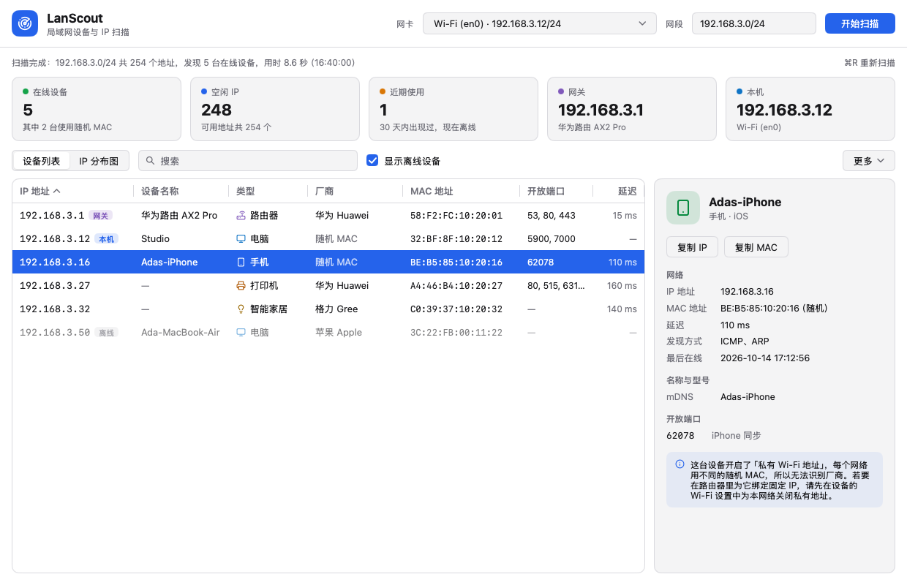
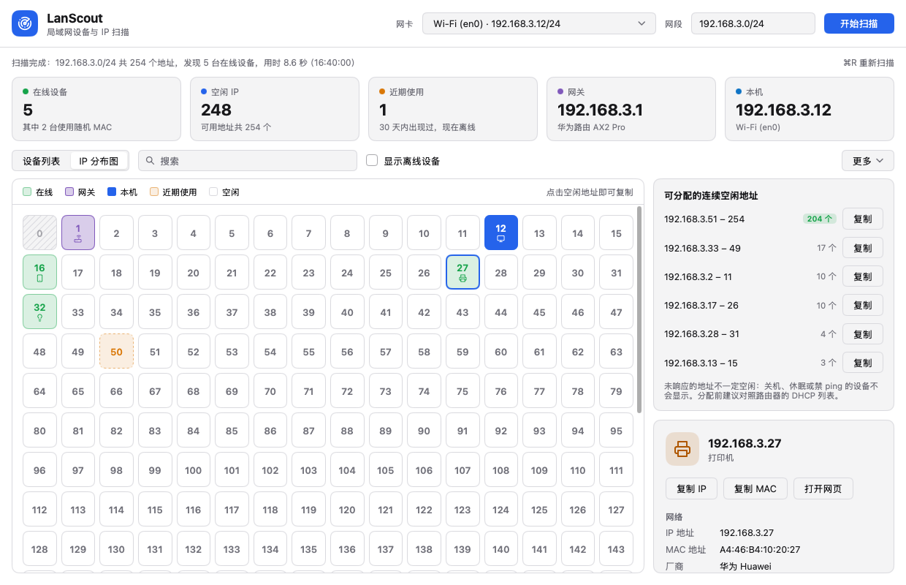

# LanScout

**看清局域网里有哪些设备、各自占用哪个 IP、还有哪些 IP 空着。**

LanScout 是一款 macOS 和 Windows 桌面应用。打开后它会自动扫描电脑所在的局域网（家用的 /24 网段大约 10 秒扫完），列出所有在线设备，并尽量认出每台设备是什么（路由器、电脑、手机、打印机、摄像头、NAS、电视……）。它还会把整个网段画成一张 IP 分布图，方便你挑一个不会冲突的地址。



## 它适合你吗

**适合这些场景：**

- 要给打印机、NAS、摄像头或服务器设置固定 IP，想先知道哪些地址空着，或者想找一段连续的空闲地址，填进路由器的 DHCP 地址池或静态分配表
- 遇到 IP 冲突，想查清某个地址现在是哪台设备在用
- 想找某台设备的 IP，比如打开打印机、摄像头或路由器的管理页面
- 想看看家里或办公室的网络里都连着哪些设备，有没有不认识的
- 不想用命令行，也不想给软件管理员权限

**不适合这些场景：**

- **跨网段管理**：LanScout 面向电脑当前所在的局域网段。手动填别的网段也能扫，但只能发现回应 ping 或开着常见端口的设备，拿不到 MAC 地址和厂商。
- **大型网络**：一次最多扫描 /20（4096 个地址），更大的网络需要分几次扫。
- **IPv6**：暂不支持。
- **安全审计、全面端口扫描**：只探测 26 个常见端口，用来判断设备类型，替代不了 nmap 这类专业工具。
- **持续监控、新设备接入提醒**：只在打开应用或手动重新扫描时扫描，不会在后台运行。
- **管理设备**：只能查看，不能踢设备下线、限速或修改设备的 IP，这些需要在路由器里操作。
- **Linux**：暂不提供 Linux 版。
- **英文界面**：目前界面只有简体中文。

## 主要功能

- **自动扫描**：打开即扫描默认网卡所在的网段（例如 `192.168.1.0/24`），结果边扫边显示。也可以换一块网卡，或者手动输入要扫的网段。
- **认出设备**：
  - 厂商：根据 MAC 地址查内置的厂商库（约 5.8 万条），常见品牌显示中文名，例如「华为 Huawei」「小米 Xiaomi」「普联 TP-Link」
  - 名称：从设备自己广播的名字、路由器分配地址时的记录、Windows 电脑的网络名、电视/路由器/NAS 的 UPnP 信息，以及设备网页的标题中获取
  - 类型和系统：结合型号、名称、开放端口和厂商，判断是路由器、电脑、手机、平板、打印机、摄像头、电视/盒子、NAS、智能音箱、游戏机、智能家居还是服务器
  - 标出网关、本机，以及使用随机 MAC（「私有 Wi-Fi 地址」）的手机
- **设备列表**：每一列都能排序，支持按 IP、名称、厂商、MAC、端口搜索。右键可以复制 IP、MAC 或名称，也可以在浏览器中打开设备的管理页面；选中一台设备，右侧会显示它的详细信息。
- **IP 分布图**：网段里每个地址一个格子，用颜色区分在线、网关、本机、近期使用和空闲。点空闲格子就会复制这个 IP。旁边列出最长的几段连续空闲地址，复制出来是 `192.168.1.100-192.168.1.199` 这样的格式，可以直接填进路由器。
- **记住离线设备**：扫描结果会保存在本机。30 天内出现过、但这次没有响应的设备（比如关机的电脑、带出门的手机）会标为「近期使用」，提醒你别把它的 IP 分给别人。家里和公司的网段即使都是 `192.168.1.0/24`，也会分开记录。
- **导出**：可以把网段里每个地址的状态（在线 / 曾使用 / 空闲）和设备信息导出成 CSV，用 Excel 直接打开；也可以把在线设备列表复制下来，粘贴到表格里。
- 跟随系统的浅色/深色模式；按 ⌘R（macOS）或 Ctrl+R（Windows）重新扫描。



## 系统要求

- macOS 12 或更高版本，Apple 芯片和 Intel 芯片的 Mac 都可以
- Windows 10 或 11，x64 或 ARM64
- 不需要管理员权限，也不需要另外安装运行库；安装包不到 10 MB

> Windows 版还没有在 Windows 电脑上完整测试过。如果遇到问题，欢迎到 [Issues](https://github.com/Qsnh/lanscout/issues) 反馈。

## 下载安装

到 [Releases](https://github.com/Qsnh/lanscout/releases) 下载最新版本：

| 系统 | 安装包 | 免安装版 |
| --- | --- | --- |
| macOS | `LanScout-<版本>-macos-universal.dmg`，打开后把 LanScout 拖进「应用程序」 | `LanScout-<版本>-macos-universal.zip`，解压即可运行 |
| Windows x64（大多数电脑） | `LanScout-<版本>-windows-amd64-setup.exe`，安装在当前用户下，不需要管理员权限 | `LanScout-<版本>-windows-amd64.zip`，解压后运行 `LanScout.exe` |
| Windows ARM64 | `LanScout-<版本>-windows-arm64-setup.exe` | `LanScout-<版本>-windows-arm64.zip` |

应用暂未做代码签名，第一次打开时系统可能会拦截：

- macOS 提示无法打开或无法验证开发者时，到「系统设置 › 隐私与安全性」，在页面下方点「仍要打开」。
- Windows 提示「Windows 已保护你的电脑」时，点「更多信息」，再点「仍要运行」。

## 第一次使用

打开 LanScout 后，它会自动扫描电脑当前连接的网络。

- **macOS**：第一次扫描时，系统会询问是否允许 LanScout「查找本地网络上的设备」，请点「允许」。如果点了拒绝，就只能扫到本机，需要到「系统设置 › 隐私与安全性 › 本地网络」里打开 LanScout，再重新扫描。
- **Windows**：Windows 防火墙可能会询问是否允许 LanScout 访问网络，选「专用网络」并允许。不允许也能扫描，只是电视、路由器这类设备可能认不出名字。

**想找一个能用的固定 IP**：切到「IP 分布图」，白色格子是空闲地址，橙色虚线格子是最近有设备用过的地址。点一个空闲格子就复制好了它的 IP。正式使用前，建议对照一下路由器的 DHCP 列表（原因见下一节）。

## 结果有多准

LanScout 通过 ping、连接常见端口和读取系统的 ARP 表来发现设备。这种方式能发现绝大多数设备，但有几点需要了解：

- **「空闲」只表示这次扫描时没有响应。** 关机、休眠或屏蔽探测的设备不会显示。正式分配固定 IP 前，最好对照一下路由器的 DHCP 列表，或者把固定 IP 放在 DHCP 地址池以外。
- **设备名称不一定都能认出来。** 能不能拿到名称，取决于设备是否对外公开自己的名字。不少智能家居设备和摄像头只能显示厂商，个别设备会显示为「未知设备」。设备类型是推断出来的，偶尔会判断错。
- **使用随机 MAC 的手机查不到厂商。** 开启了「私有 Wi-Fi 地址」的手机在每个网络里用不同的随机 MAC。如果要在路由器里给它绑定固定 IP，需要先在手机上对这个网络关闭私有地址。
- **访客网络、开启了「AP 隔离」的 Wi-Fi 里，设备之间互相看不到**，通常只能扫到本机和网关。

## 隐私与网络行为

- 不需要注册账号，不收集、不上传任何数据，也不会自动检查更新。
- 扫描时只向你选择的网段内的地址发送探测。唯一的例外是查询设备名称时的反向 DNS 请求，它会发给电脑当前使用的 DNS 服务器（通常就是路由器）。
- 只读取信息，不会修改任何设备的设置。
- 扫描记录只保存在本机，可以通过「更多 › 清除本网段的历史记录」删除当前网段的记录。卸载后如果想彻底清除，删除下面这个文件夹即可：
  - macOS：`~/Library/Application Support/LanScout/`
  - Windows：`%AppData%\LanScout\`
- 扫描会对网段内的每个地址发送 ping，并尝试连接常见端口。在公司等有专人管理的网络里，这可能被安全设备记录为扫描行为，请只在你有权管理的网络里使用。

## 命令行版

如果电脑上装了 [Go](https://go.dev/dl/) 1.27 或更高版本，也可以不打开窗口，直接在终端里扫描，适合排查问题或配合脚本使用：

```sh
go run github.com/Qsnh/lanscout/cmd/lanscan@latest                   # 扫描默认网卡所在的网段
go run github.com/Qsnh/lanscout/cmd/lanscan@latest -net 10.0.0.0/22  # 扫描指定网段
go run github.com/Qsnh/lanscout/cmd/lanscan@latest -if en0           # 从指定网卡扫描
```

结果以文本表格输出，包含 IP、MAC、厂商、名称、类型、系统、开放端口和延迟。

## 常见问题

**为什么只扫到了本机？**
macOS 请检查「本地网络」权限（见「第一次使用」）；Windows 请检查防火墙是否拦截了 LanScout。另外确认电脑连接的不是访客网络。

**某台手机没有出现？**
手机锁屏后可能暂时不响应。点亮手机屏幕后，按 ⌘R / Ctrl+R 再扫一次。

**公司网络是 `10.0.0.0/16` 这样的大网段，能扫吗？**
一次最多扫描 /20（4096 个地址）。网段大于 /20 时，LanScout 默认只扫描本机所在的那个 /24；你也可以在「网段」里依次填入 `10.0.0.0/20`、`10.0.16.0/20`……分几次扫描，或者只填你关心的那一段。

## 从源码构建

开发、打包和发布说明见 [docs/DEVELOPMENT.md](docs/DEVELOPMENT.md)。
